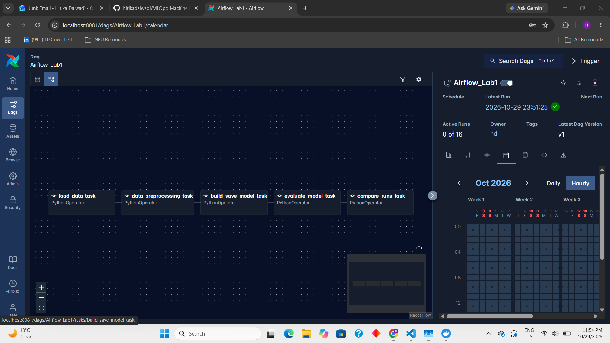
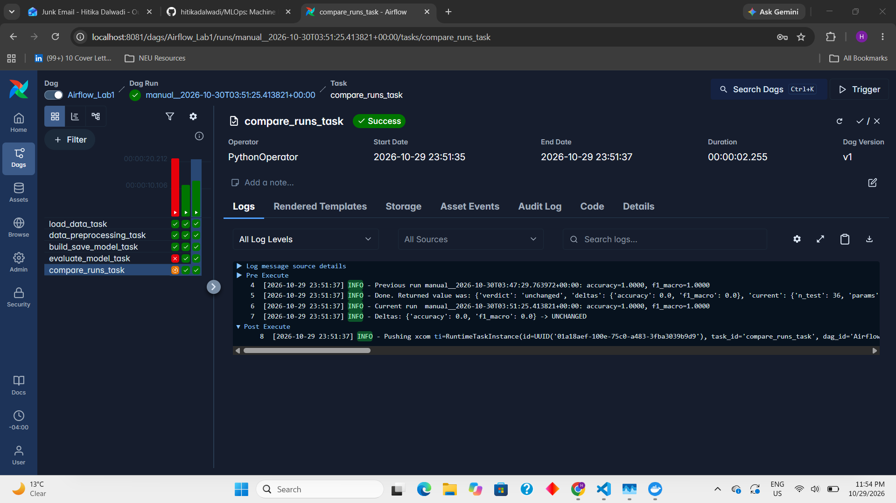

# Airflow lab

- In order to install Airflow using docker you can watch our [Airflow Lab1 Tutorial Video](https://youtu.be/exFSeGUbn4Q?feature=shared)
- For latest step-by-step instructions, check out this blog - [AirFlow Lab-1](https://www.mlwithramin.com/blog/airflow-lab1)

### ML Model

This lab trains a wine classifier inside an Airflow DAG and tracks how each run compares with the previous one. It loads the wine dataset from CSV, preprocesses it, trains and saves a random forest classifier, scores the model on a held-out test set, and compares the scores with those of the previous run.

#### Dataset

The [scikit-learn wine dataset](https://scikit-learn.org/stable/datasets/toy_dataset.html#wine-recognition-dataset) (13 chemical features, 3 wine classes in the `target` column), split 80/20 with a stratified split and `random_state=42`:

- `dags/data/wine_train.csv` - 142 rows, used for training
- `dags/data/wine_test.csv` - 36 rows, used for evaluation

#### Prerequisites

Before using this script, make sure you have the following libraries installed:

- pandas
- scikit-learn (sklearn)

#### Usage

You can call the functions in `dags/src/lab.py` directly, outside Airflow, from the `dags/` directory:

```python
from src.lab import (
    load_data, data_preprocessing, build_save_model,
    evaluate_model, compare_with_previous_run,
)

data = load_data()
preprocessed_data = data_preprocessing(data)
params = build_save_model(preprocessed_data, 'model.sav')
metrics = evaluate_model('model.sav', params, run_id='manual_run_1')
print(compare_with_previous_run(metrics))
```

#### Functions

1. **load_data()**
   - *Description:* Loads `wine_train.csv`, serializes it, and returns it as a base64 string.

2. **data_preprocessing(data)**
   - *Description:* Deserializes the data, drops incomplete rows, splits it into features (`X`) and labels (`y`), and returns them serialized.

3. **build_save_model(data, filename)**
   - *Description:* Trains a `RandomForestClassifier` (200 trees, max depth 6), saves it to `dags/model/<filename>`, and returns the hyperparameters.

4. **evaluate_model(filename, model_params, run_id)**
   - *Description:* Loads the saved model and scores it on `wine_test.csv`. The argument is called `model_params` because Airflow reserves the name `params` for its own context. It returns the accuracy and macro F1 and appends them to `dags/model/metrics_history.json`. Entries are keyed by `run_id`, so a retried task replaces its own entry instead of adding a duplicate.

5. **compare_with_previous_run(metrics)**
   - *Description:* Compares the current metrics with the previous entry in the history file and returns the deltas and a verdict:

     | Verdict | Meaning |
     |---|---|
     | `baseline` | No earlier run exists, so this run is the reference |
     | `improved` | Accuracy rose by more than 0.01 |
     | `unchanged` | Accuracy changed by 0.01 or less |
     | `regressed` | Accuracy fell by more than 0.01 |

     The threshold is `REGRESSION_TOLERANCE` in `lab.py`.

The pipeline is deterministic (fixed seeds and a fixed dataset), so re-triggering with no changes gives `unchanged`. To see `improved` or `regressed`, change the hyperparameters in `build_save_model` and trigger the DAG again.

### Airflow Setup

Use Airflow to author workflows as directed acyclic graphs (DAGs) of tasks. The Airflow scheduler executes your tasks on an array of workers while following the specified dependencies.

References

-   Product - https://airflow.apache.org/
-   Documentation - https://airflow.apache.org/docs/
-   Github - https://github.com/apache/airflow

#### Installation

Prerequisites: You should allocate at least 4GB memory for the Docker Engine (ideally 8GB).

Local

-   Docker Desktop Running

Cloud

-   Linux VM
-   SSH Connection
-   Installed Docker Engine - [Install using the convenience script](https://docs.docker.com/engine/install/ubuntu/#install-using-the-convenience-script)

#### Tutorial

1. Create a new directory

    ```bash
    mkdir -p ~/app
    cd ~/app
    ```

2. Running Airflow in Docker - [Refer](https://airflow.apache.org/docs/apache-airflow/stable/howto/docker-compose/index.html#running-airflow-in-docker)

    a. You can check if you have enough memory by running this command

    ```bash
    docker run --rm "debian:bullseye-slim" bash -c 'numfmt --to iec $(echo $(($(getconf _PHYS_PAGES) * $(getconf PAGE_SIZE))))'
    ```

    b. Fetch [docker-compose.yaml](https://airflow.apache.org/docs/apache-airflow/stable/docker-compose.yaml)

    ```bash
    curl -LfO 'https://airflow.apache.org/docs/apache-airflow/stable/docker-compose.yaml'
    ```

    c. Setting the right Airflow user

    ```bash
    mkdir -p ./dags ./logs ./plugins ./config
    echo -e "AIRFLOW_UID=$(id -u)" > .env
    ```

    d. Update the following in docker-compose.yaml

    ```bash
    # Do not load examples
    AIRFLOW__CORE__LOAD_EXAMPLES: 'false'

    # Additional python package (the DAG needs pandas and scikit-learn)
    _PIP_ADDITIONAL_REQUIREMENTS: ${_PIP_ADDITIONAL_REQUIREMENTS:-pandas scikit-learn}
    ```

    Optionally change the default admin credentials (`airflow` / `airflow`) with `_AIRFLOW_WWW_USER_USERNAME` and `_AIRFLOW_WWW_USER_PASSWORD`.

    e. Initialize the database

    ```bash
    docker compose up airflow-init
    ```

    f. Running Airflow

    ```bash
    docker compose up
    ```

    Wait until the containers report `healthy` (check with `docker compose ps`).

    g. Enable port forwarding

    h. Visit `localhost:8080` and log in with the credentials from step `2.d`

    If port 8080 is already in use by another stack, publish a different host port by changing the `ports` mapping of the web service, for example `8081:8080`.

3. Explore UI and add user `Security > List Users`

4. Create a python script [`dags/sandbox.py`](dags/sandbox.py)

    - BashOperator
    - PythonOperator
    - Task Dependencies
    - Params
    - Crontab schedules

    You can have n number of scripts inside dags dir

5. Stop docker containers

    ```bash
    docker compose down
    ```
### Airflow DAG Script

`dags/airflow.py` defines the DAG `Airflow_Lab1`. Each task represents one step of the training and evaluation workflow and passes its result to the next task through XCom.

#### Importing Libraries

```python
from airflow import DAG
from airflow.providers.standard.operators.python import PythonOperator
from datetime import datetime, timedelta
from src.lab import (
    load_data,
    data_preprocessing,
    build_save_model,
    evaluate_model,
    compare_with_previous_run,
)
```

The `DAG` and `PythonOperator` imports use the Airflow 3 layout (`PythonOperator` now lives in the standard provider). The workflow functions come from `src/lab.py`.

Every task returns a base64 string or a plain dict, so the default JSON XCom backend works and XCom pickling does not need to be enabled.

#### Define default arguments for your DAG

```python
default_args = {
    'owner': 'hd',
    'start_date': datetime(2026, 10, 29),
    'retries': 0,
    'retry_delay': timedelta(minutes=5),
}
```

#### Create the DAG

```python
with DAG(
    'Airflow_Lab1',
    default_args=default_args,
    description='Wine classifier: train, evaluate, and compare against the previous run',
    schedule=None,  # Trigger manually
    catchup=False,
) as dag:
```

`schedule=None` means the DAG only runs when triggered manually. `catchup=False` prevents backfilling of missed runs.

#### Tasks

```python
load_data_task = PythonOperator(
    task_id='load_data_task',
    python_callable=load_data,
)

data_preprocessing_task = PythonOperator(
    task_id='data_preprocessing_task',
    python_callable=data_preprocessing,
    op_args=[load_data_task.output],
)

build_save_model_task = PythonOperator(
    task_id='build_save_model_task',
    python_callable=build_save_model,
    op_args=[data_preprocessing_task.output, "model.sav"],
)

evaluate_model_task = PythonOperator(
    task_id='evaluate_model_task',
    python_callable=evaluate_model,
    op_args=["model.sav", build_save_model_task.output],
)

compare_runs_task = PythonOperator(
    task_id='compare_runs_task',
    python_callable=compare_with_previous_run,
    op_args=[evaluate_model_task.output],
)
```

- `load_data_task` reads the training CSV.
- `data_preprocessing_task` cleans the data and splits features from labels.
- `build_save_model_task` trains the random forest and saves it.
- `evaluate_model_task` scores the model on the test set and records the metrics. Airflow passes the `run_id` argument of `evaluate_model` automatically from the task context.
- `compare_runs_task` compares the metrics with the previous run and returns the verdict.

#### Set task dependencies

```python
load_data_task >> data_preprocessing_task >> build_save_model_task >> evaluate_model_task >> compare_runs_task
```

#### If this script is run directly, test the DAG

```python
if __name__ == "__main__":
    dag.test()
```

### Running the DAG in Docker

#### Prerequisites

- Docker: Make sure Docker is installed and running on your system.

#### Step 1: Directory Structure

Ensure your project has the following directory structure:

```plaintext
Lab_1/
├── dags/
│   ├── airflow.py              # DAG script
│   ├── src/
│   │   ├── __init__.py
│   │   └── lab.py              # Data processing, modeling, and evaluation functions
│   ├── data/
│   │   ├── wine_train.csv      # Training data
│   │   └── wine_test.csv       # Held-out test data
│   └── model/                  # Created at run time: model.sav and metrics_history.json
├── config/
├── docker-compose.yaml         # Docker Compose configuration
└── .env
```

#### Step 2: Docker Compose Configuration

Create a docker-compose.yaml file in the project root directory (see step `2.b` above). The `dags/` folder is mounted into the containers, so the DAG, its data, and the `model/` output all live on your machine.

#### Step 3: Start the Docker containers

```bash
docker compose up
```

Wait until `docker compose ps` shows the services as `healthy`.

#### Step 4: Access Airflow Web Interface

- Open a web browser and navigate to http://localhost:8080 (or the host port you chose).

- Log in with the credentials set in step `2.d` (default `airflow` / `airflow`).

#### Step 5: Trigger the DAG

- In the Airflow web interface, navigate to the "DAGs" page.

- You should see `Airflow_Lab1` listed. If it shows an import error instead, open the error banner; a missing `pandas` or `sklearn` package means `_PIP_ADDITIONAL_REQUIREMENTS` was not applied.

- Click "Trigger" to start a run, and monitor the task status and logs in the UI.

#### Step 6: Pipeline Outputs

- `dags/model/model.sav` - the trained model.
- `dags/model/metrics_history.json` - accuracy and macro F1 for every run.
- The log of `compare_runs_task` shows the previous run's metrics, this run's metrics, the deltas, and the verdict. The same dict is available as the task's XCom return value.

Trigger the DAG a second time, after changing a hyperparameter in `build_save_model`, to see the comparison against the first run.

### Screenshots

DAG graph in the Airflow UI (`Airflow_Lab1`, five tasks):



Log of `compare_runs_task`, showing the previous run, the current run, the deltas, and the verdict:



### Changes Made

- Dataset changed from credit card data to the wine dataset
- Model changed from KMeans clustering to a random forest classifier
- Added `evaluate_model_task` to score the model on a test set
- Added `compare_runs_task` to compare each run with the previous one
- Added `docker-compose.yaml` (latest Airflow) with the web port set to 8081
